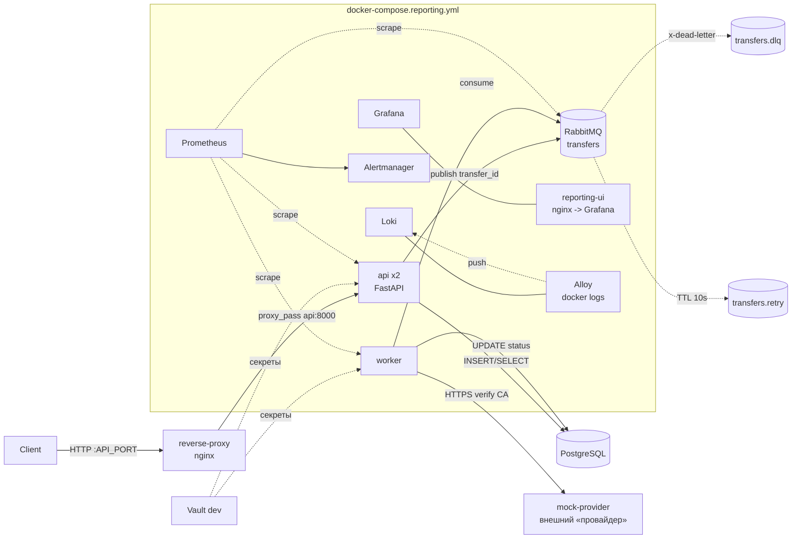
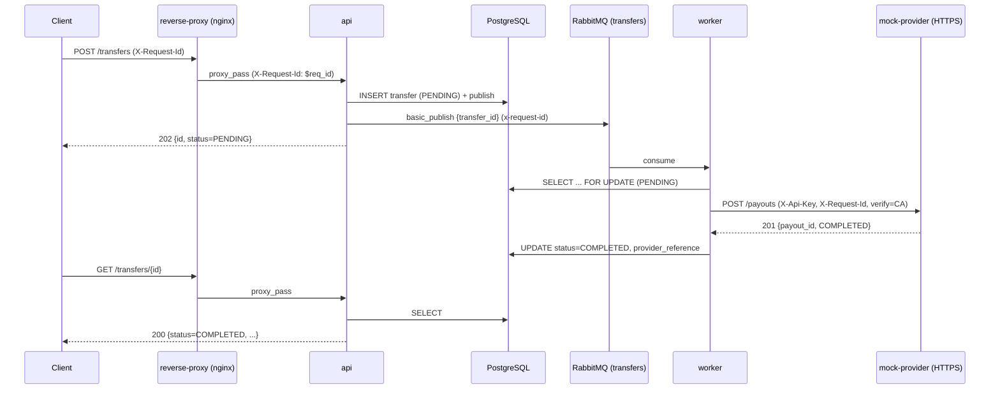
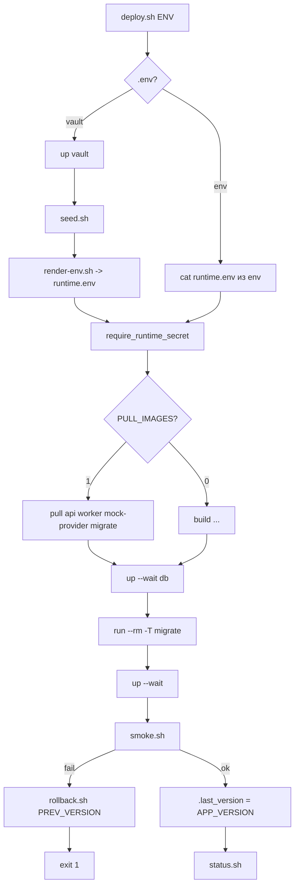

# Architecture

## 1. Компоненты

**Сервисы (`docker-compose.yml`):**
- `vault` (dev) — секреты; `db` (Postgres 16); `rabbitmq` (3.13-management + `rabbitmq_prometheus`).
- `migrate` (one-shot, профиль `tools`) — миграции до раскатки (advisory lock + lock_timeout).
- `api` (2 реплики) — `/health` (БД+RabbitMQ), `/transfers` (POST/GET), `/metrics`.
- `worker` — consume `transfers` → Postgres → mock-provider (`/payouts`).
- `certs-init` (init, root) — chown тома `provider-certs`; `mock-provider` (HTTPS, self-signed).
- `reverse-proxy` (nginx) — вход клиента, `resolver` + `set $api_upstream`.

**Наблюдаемость (`docker-compose.reporting.yml`):**
- `prometheus` (+ rules), `alertmanager`, `grafana` (provisioned datasource/dashboard), `reporting-ui` (nginx → Grafana), `loki`, `alloy` (docker logs → Loki).

## 2. Поток обработки перевода

**Очереди (RabbitMQ, `declare_topology` из env, идемпотентно):**
- `transfers` → `x-dead-letter-exchange=transfers.dlx` → `transfers.dlq` (после `WORKER_MAX_RETRIES`).
- `transfers.retry` — TTL 10s, `x-dead-letter-exchange=""` (default) → `transfers` (backoff).
- Ошибка worker: `x-retry-count+1` → publish в `transfers.retry` → TTL → `transfers`; после N → `nack(requeue=False)` → DLQ.

## 3. Поток деплоя (`deploy.sh`)

- **Идемпотентно:** `up -d --wait`, без `down -v`; миграции one-shot (не из реплик).
- **Smoke + автооткат:** `/health` (retry) → POST → GET; при провале — `rollback.sh` (схема **не** откатывается — forward-only).
- **`APP_VERSION`** из `git describe`; тег образа; `.last_version` для отката.

## 4. Границы доверия

| Канал | Протокол | Доверие |
|---|---|---|
| Клиент → nginx → api | HTTP (тест); прод — TLS-терминация (Let's Encrypt/secret) | клиентский вход; **единственный** порт наружу: `0.0.0.0:${API_PORT}` (тест — localhost; прод — за LB/TLS) |
| api/worker ↔ db/rabbitmq | plain (docker-сеть, изолирована) | прод — mTLS/service mesh |
| worker → mock-provider | **HTTPS**, `verify=PROVIDER_CA_BUNDLE` (`/certs/cert.pem`, SAN=DNS:mock-provider) | **внешний** канал; `verify=False` убран (MITM) |
| api/worker ← Vault (dev) | HTTP (127.0.0.1) | секреты; mock-provider — только `PROVIDER_API_KEY` (наименьшие привилегии) |

**Порты:**
- **Наружу:** `reverse-proxy` `0.0.0.0:${API_PORT}` (клиент; тест — localhost; прод — LB/TLS).
- **127.0.0.1 (не наружу):** `vault:8200`, `rabbitmq-mgmt:15672`, `prometheus:9090`, `alertmanager:9093`, `reporting-ui:8090` (Grafana), `loki:3100`, `alloy:12345`.
- **Внутри сети (без publish):** `api:8000`, `worker:8001`, `mock-provider:9443`, `db:5432`, `rabbitmq:5672/15692`.

**Метки:** `com.northwind.owner: payments` (бизнес), `analytics` (наблюдаемость).

## 5. Наблюдаемость

- **RED (api):** `api_requests_total{method,path,status}`, `http_request_duration_seconds`, `api_in_flight`.
- **Бизнес:** `transfers_created_total`, `transfers_total{status}`, `oldest_pending_age_seconds` (worker).
- **RabbitMQ per-queue:** `RABBITMQ_PROMETHEUS_RETURN_PER_OBJECT_METRICS=true` → `rabbitmq_queue_messages_ready{queue="transfers.dlq"}`.
- **Алерты:** `OldestPendingTooOld` (>300s), `TransfersDLQNotEmpty` (per-queue), `ApiDown`/`WorkerDown` (`up==0`), `NoTargetsUp` (`absent(up)` — dead man's switch).
- **Логи:** `json-file` (10m×3) + Loki (Alloy, `payment-stack-*`, retention 7d); `request_id` сквозной (api→queue→worker→provider, в ответе).
- **Дашборд «Payments»:** transfers, oldest_pending (60/300), DLQ (per-queue), by status, up, Logs (Loki) — «работают?» за 10с.

## 6. Секреты

`.env` → `seed.sh` → **Vault** (`secret/payment-stack/<env>`) → `render-env.sh` → `runtime.env` (chmod 600) → контейнеры; `deploy.sh` экспортирует для compose (`PROVIDER_API_KEY`, `GRAFANA_ADMIN_PASSWORD` под reporting). CI — `SECRETS_SOURCE=env` (из `env:` job'а, без Vault). «Нет секрета» — `:?`/`require_runtime_secret` → падаем с сообщением.